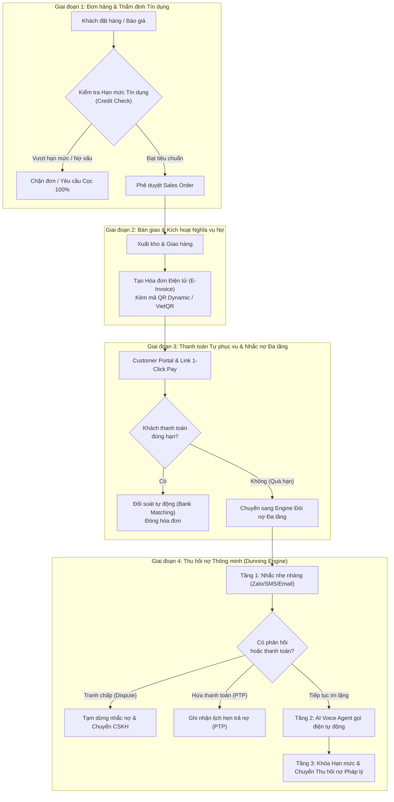

# BÁO CÁO PHÂN TÍCH VÀ ĐỀ XUẤT NGHIỆP VỤ TỐI ƯU
## ĐỀ TÀI: QUẢN LÝ ĐƠN HÀNG, CÔNG NỢ VÀ THU HỒI NỢ TỰ ĐỘNG (ORDER-TO-CASH & AR AUTOMATION)
**Môn học:** Công nghệ tài chính và ứng dụng (FinTech & Applications)  
**Chuyên đề:** Quản trị công nợ & Tự động hóa tài chính (Debt Management)  
**Phương pháp thực hiện:** Dịch ngược kiến trúc (Reverse Engineering Analysis - REA)

---

## I. TỔNG QUAN VÀ PHƯƠNG PHÁP LUẬN ĐÁNH GIÁ (REA METHODOLOGY)

Dựa trên phương pháp phân tích dịch ngược hệ thống (REA - Reverse Engineer Anything), 5 nền tảng đại diện cho 2 trường phái giải pháp tài chính được khảo sát:
1. **Trường phái Core ERP & Kế toán truyền thống:**
   * **QuickBooks Online (Intuit):** Tiêu chuẩn kế toán SMB Bắc Mỹ, tính ổn định cao nhưng cơ chế đòi nợ thụ động và phân tầng tính năng khắt khe.
   * **Odoo Accounting:** ERP mô-đun nguồn mở, liên kết chuỗi cung ứng chặt chẽ, tối ưu luồng trạng thái từ Kho đến Hóa đơn.
   * **Zoho Books:** Hệ sinh thái quản trị SMB toàn diện, tự động hóa bằng Workflow Rules, tối ưu chi phí và trải nghiệm Client Portal.
2. **Trường phái FinTech AR & Đòi nợ thông minh (Specialized AR Automation):**
   * **Reimber:** Lớp ứng dụng chuyên sâu về Quản trị phân loại nợ (Aging Buckets), Phân luồng công việc cho nhân viên thu hồi nợ (Daily Worklists), và Theo dõi tranh chấp (Dispute Tracking).
   * **AccountsReceivable.ai:** Giải pháp cận biên sử dụng AI Agent tự hành đa kênh (AI Voice Calling, Smart Remittance Matching, Payment Date Prediction).

---

## II. MA TRẬN BÓC TÁCH VÀ ĐÁNH GIÁ 5 NỀN TẢNG THỰC TẾ

| Tiêu chí phân tích | QuickBooks Online | Odoo Accounting | Zoho Books | Reimber | AccountsReceivable.ai |
| :--- | :--- | :--- | :--- | :--- | :--- |
| **Bản chất kiến trúc** | Monolithic Accounting Cloud | Modular State-Machine ERP | Workflow-Driven Accounting | Overlay AR Collections Microservice | Autonomous AI AR Agent |
| **Khởi tạo Đơn bán (Sales Order)** | Bị chặn dưới gói Plus ($140/tháng) | Liên kết app Sales $\rightarrow$ Kho $\rightarrow$ Kế toán | Có từ gói Professional ($40/tháng) | Không hỗ trợ (phụ thuộc QBO/NetSuite) | Không hỗ trợ (phụ thuộc ERP bên ngoài) |
| **Luồng hóa đơn & Thu tiền** | Gửi email đính kèm link thanh toán | Ghi nhận hóa đơn $\rightarrow$ Đối soát sao kê | Gửi link qua Portal $\rightarrow$ Thanh toán tự động | Đồng bộ Invoice $\rightarrow$ Nhắc nợ qua Email/SMS | Đồng bộ Invoice $\rightarrow$ Gọi thoại AI + Email |
| **Cơ chế đòi nợ (Dunning)** | **Thụ động:** Nhắc nợ thủ công hoặc template cơ bản | **Bán tự động:** Cần cấu hình cron job/hành động tự động | **Tự động theo luật:** Workflow quy định số ngày quá hạn | **Thông minh có giám sát:** Phân tích aging, worklist theo độ ưu tiên | **Hoàn toàn tự động:** AI gọi điện thoại, dự đoán ngày thanh toán |
| **Xử lý tranh chấp & Lời hứa trả tiền** | Ghi chú thủ công (Note) | Ghi chú trong Chatter | Tạo Comment/Custom Field | Chuyên biệt hóa (Dispute & Promises-to-Pay) | Phân tích qua hội thoại AI Voice/Email |
| **Điểm nghẽn / Hạn chế lớn nhất** | Chi phí nâng gói cao, phụ thuộc thao tác người | Bẫy chi phí khi cài app thứ 2; khó cấu hình | Giới hạn hóa đơn/doanh thu ở gói thấp | Quá đắt đối với SMB ($490 - $1200/mo) | Rủi ro "hộp đen" AI gây xung đột quan hệ khách hàng |

---

## III. THIẾT KẾ MÔ HÌNH NGHIỆP VỤ TỐI ƯU VÀ HỢP LÝ NHẤT
*(Mô hình Kết hợp Tinh hoa: **Hybrid Autonomous Order-to-Cash & Smart Debt Engine**)*

Một quy trình quản lý nợ tối ưu không thể chỉ dừng lại ở việc "đến hạn thì đi đòi" (như QuickBooks), cũng không thể để AI gọi điện đòi nợ vô tội vạ làm mất khách (rủi ro của AI AR thuần túy). 

Mô hình tối ưu nhất là **quản trị rủi ro nợ ngay từ khi duyệt đơn hàng**, kết hợp **cổng thanh toán tự phục vụ** và **hệ thống phân kỳ đòi nợ tự động đa tầng (Multi-tier Escalation)**.

---

## IV. QUY TẮC NGHIỆP VỤ CỐT LÕI (CORE BUSINESS RULES)

### 1. Quy tắc Thẩm định Tín dụng Đầu vào (Pre-Order Credit Scoring)
* **Rule 1.1 (Credit Limit Threshold):** Mỗi khách hàng B2B được cấp một Hạn mức tín dụng khả dụng:
  $$\text{Hạn mức còn lại} = \text{Hạn mức phê duyệt} - (\text{Nợ chưa thanh toán} + \text{Giá trị đơn hàng mới})$$
  *Nếu Hạn mức còn lại $< 0$, hệ thống tự động khóa đơn hàng và yêu cầu thanh toán công nợ cũ hoặc đặt cọc.*
* **Rule 1.2 (Overdue Aging Lock):** Nếu khách hàng có bất kỳ hóa đơn nào quá hạn trên **15 ngày**, hệ thống tự động đình chỉ quyền tạo Sales Order mới bất kể hạn mức tín dụng còn hay không.

### 2. Quy tắc Nhúng Cổng Thanh toán 1-Click (Frictionless Payment)
* **Rule 2.1:** Mọi hóa đơn xuất ra bắt buộc sinh kèm **Mã QR Động (Dynamic VietQR / Payment Link)** chứa mã tham chiếu dạng: `INV_[MãHóaĐơn]_[MãKhách]`.
* **Rule 2.2 (Customer Portal):** Cung cấp đường dẫn bảo mật (Magic Link không cần mật khẩu) cho phép khách hàng vào tự tra cứu sao kê công nợ, đối chiếu hóa đơn và bấm thanh toán trực tiếp.

### 3. Quy tắc Đòi nợ Đa tầng Thích ứng (Adaptive Multi-Tier Dunning Cadence)

| Mốc thời gian | Tầng xử lý | Kênh giao tiếp | Hành động nghiệp vụ |
| :--- | :--- | :--- | :--- |
| **T - 3 ngày** | Nhắc hẹn trước hạn | Email / Zalo ZNS | Gửi thông báo lịch sự nhắc ngày đến hạn kèm đường dẫn hóa đơn gốc và mã QR thanh toán. |
| **T + 0 ngày** | Đúng hạn | Email / SMS | Thông báo hóa đơn đã đến hạn hôm nay. |
| **T + 3 ngày** | Quá hạn nhẹ (Tầng 1) | Zalo ZNS / Tin nhắn SMS | Nhắc nhở quá hạn lần 1, hỏi xem khách hàng có gặp vấn đề kỹ thuật khi thanh toán không. |
| **T + 7 ngày** | Quá hạn trung bình (Tầng 2) | Cuộc gọi tự động (AI Voice Agent) | AI Agent gọi điện trực tiếp, xưng danh công ty, hỏi lý do chậm trễ và xin **Cam kết ngày thanh toán (Promise to Pay - PTP)**. |
| **T + 15 ngày** | Quá hạn nghiêm trọng (Tầng 3)| Khóa quyền mua hàng + Email cảnh báo | Tự động hạ hạn mức tín dụng về 0, gửi thông báo phạt chậm trả (nếu có trong hợp đồng) và cảnh báo ngưng cung cấp dịch vụ. |
| **T + 30 ngày** | Nợ xấu (Default) | Bàn giao Nhân sự Pháp chế | Trích xuất toàn bộ bằng chứng giao nhận (Proof of Delivery), lịch sử hóa đơn, lịch sử liên hệ để chuẩn bị hồ sơ pháp lý đòi nợ. |

### 4. Quy tắc Xử lý Ngoại lệ: Lời hứa trả nợ (PTP) & Tranh chấp (Disputes)
* **Promise-to-Pay (PTP):** Khi khách hàng cam kết *"Tôi sẽ chuyển khoản vào ngày X"*, AI/Nhân viên cập nhật trường `ptp_date = X`. Toàn bộ chuỗi nhắc nợ tự động **tạm hoãn** cho đến ngày `X + 1`. Nếu đến `X + 1` vẫn chưa có giao dịch, quy trình sẽ nhảy thẳng lên Tầng 2 với mức độ nghiêm khắc hơn.
* **Dispute Flag:** Nếu khách hàng phản hồi hóa đơn có sai sót về số lượng, giá hoặc chất lượng hàng, hệ thống đánh dấu trạng thái `Disputed`. Ngừng ngay việc đòi nợ để tránh làm mất lòng khách và tự động tạo phiếu ticket cho bộ phận Kinh doanh/Kho đối soát.

### 5. Quy tắc Đối soát và Xóa nợ Tự động (Cash Application & Auto-Reconciliation)
* **Rule 5.1:** Lắng nghe Webhook biến động số dư ngân hàng theo thời gian thực (Real-time Bank Webhook).
* **Rule 5.2:** Phân tích nội dung chuyển khoản bằng Regex / Fuzzy matching để bóc tách mã hóa đơn:
  * Nếu số tiền khớp 100%: Chuyển trạng thái hóa đơn sang `PAID`, khôi phục hạn mức tín dụng cho khách hàng.
  * Nếu thanh toán thiếu (Partial Payment): Khấu trừ theo nguyên tắc hóa đơn phát hành trước thì trừ trước (FIFO - First In First Out) và cập nhật số dư còn lại.

---

## V. ĐỀ XUẤT KIẾN TRÚC CÔNG NGHỆ ỨNG DỤNG CHO DỰ ÁN FINTECH

Để hiện thực hóa mô hình nghiệp vụ trên mà không bị tốn chi phí thuê bao khổng lồ của các phần mềm ngoại, kiến trúc tối ưu nhất gồm:

1. **Backend & Core Ledger:**
   * Sử dụng kiến trúc Microservices nhẹ (Node.js/Python FastAPI) kết hợp cơ sở dữ liệu quan hệ PostgreSQL để đảm bảo tính toàn vẹn tài chính (ACID).
2. **Tự động hóa luồng (Workflow Engine):**
   * Sử dụng máy trạng thái hữu hạn (Finite State Machine) quản lý vòng đời hóa đơn: `Draft` $\rightarrow$ `Issued` $\rightarrow$ `Partially Paid` $\rightarrow$ `Paid` $\rightarrow$ `Overdue` $\rightarrow$ `Disputed` $\rightarrow$ `Default`.
3. **Cổng thanh toán & Ngân hàng số:**
   * Tích hợp Open Banking API / VietQR động của các ngân hàng Việt Nam (VietinBank, Techcombank, MB,...) hoặc cổng thanh toán (PayOS, Sepay, MoMo) để nhận biến động số dư qua Webhook.
4. **Hệ thống liên lạc đa kênh chi phí tối ưu:**
   * Zalo Cloud API (ZNS) + SMS Brandname cho các thông báo nhẹ nhàng.
   * Kết hợp Webhook cuộc gọi tự động (Auto-call) tích hợp LLM tóm tắt nội dung khi cần xác nhận PTP.

---
*Báo cáo được hoàn thành và đối chiếu với các nguyên tắc bảo mật và kiến trúc dữ liệu tài chính hiện đại.*
