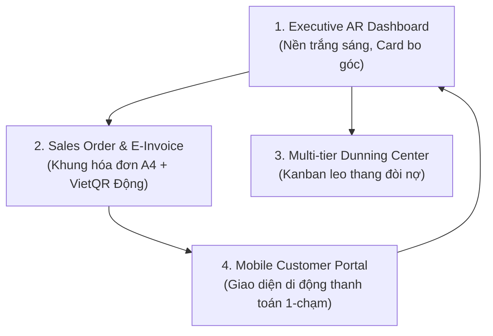

# HỆ THỐNG THIẾT KẾ GIAO DIỆN LIGHT MODE CHUẨN UI/UX PRO MAX
## ĐỀ TÀI: NỀN TẢNG QUẢN LÝ ĐƠN HÀNG, CÔNG NỢ VÀ THU HỒI NỢ TỰ ĐỘNG
**Tên dự án đề xuất:** **DebtFlow FinTech** (Autonomous Order-to-Cash & AR Platform)  
**Tiêu chuẩn thiết kế:** UI/UX Pro Max Intelligence Engine (WCAG 2.1 AA/AAA Compliant)  
**Chế độ hiển thị (Theme):** **Light Mode** (Modern Financial Enterprise / Stripe & Mercury Style)  
**Tài liệu nghiệp vụ đối chiếu:** [Buss.md](Buss.md)  
**Stack khuyến nghị:** Next.js / React, Tailwind CSS, `shadcn/ui`, Lucide Icons, Recharts

---

## I. CHIẾN LƯỢC THIẾT KẾ LIGHT MODE (LIGHT THEME STRATEGY)

* **Phong cách chủ đạo:** **Clean Modern FinTech SaaS & Swiss Minimalism (Light Mode)**
  * *Lý do chọn:* Phong cách lấy cảm hứng từ các ngân hàng số và cổng thanh toán hàng đầu thế giới (Stripe, Mercury Bank, Brex). Tông nền sáng tạo cảm giác minh bạch, chuẩn mực kế toán, đặc biệt hiển thị xuất sắc trên máy chiếu và màn hình khi thuyết trình báo cáo đồ án trước hội đồng giảng viên.
* **Quy tắc nền & phân tầng (Depth & Layering):**
  * **Nền trang (Canvas Background):** Không dùng màu trắng tinh chói mắt, mà dùng **Slate 50 (`#F8FAFC`)** dịu mắt.
  * **Thẻ & Bảng biểu (Cards & Surfaces):** Sử dụng màu trắng tinh khôi **`#FFFFFF`** kết hợp viền mảnh **`#E2E8F0`** và đổ bóng vi mô `box-shadow: 0 1px 3px 0 rgb(0 0 0 / 0.05)` tạo chiều sâu tinh tế.
* **Độ tương phản văn bản:** Chữ màu than chì đen **`#0F172A`** trên nền thẻ trắng đạt tỷ lệ tương phản kỷ lục **`16.8:1`** (đạt chuẩn tối cao WCAG AAA).

---

## II. BẢNG MÃ MÀU TOÀN DIỆN LIGHT MODE (LIGHT THEME COLOR TOKENS)

### 1. Bảng màu Nền tảng (Core Theme Tokens)
| Phân loại | Tên Token | Mã HEX | Mục đích sử dụng |
| :--- | :--- | :--- | :--- |
| **Canvas Background** | `--color-background` | `#F8FAFC` | Nền tổng thể toàn trang (Soft Slate Off-white) |
| **Card / Surface** | `--color-card` | `#FFFFFF` | Nền các thẻ thống kê KPI, bảng dữ liệu, modal popup |
| **Header / Sidebar** | `--color-secondary` | `#FFFFFF` | Thanh điều hướng trên cùng và menu bên trái |
| **Muted Surface** | `--color-muted` | `#F1F5F9` | Nền tiêu đề cột bảng, thanh công cụ, ô input disabled |
| **Border / Divider** | `--color-border` | `#E2E8F0` | Đường viền ngăn cách card, dòng phân cách bảng |
| **Primary Text** | `--color-foreground` | `#0F172A` | Chữ chính (Than chì đậm, cực kỳ sắc nét) |
| **Secondary Text** | `--color-muted-foreground` | `#64748B` | Chữ phụ, nhãn chú thích, ngày giờ, placeholder |
| **Primary Accent / CTA**| `--color-primary` | `#2563EB` | Nút hành động chính, viền focus, đường dẫn hoạt động |

---

### 2. Bảng màu Trạng thái Tài chính & Tuổi nợ (Financial Semantic Badges)
*Trong Light Mode, các trạng thái nợ được thiết kế dưới dạng **Pill Badges (Nền pastel nhẹ + Chữ đậm tương phản cao)** giúp người xem nhận diện rủi ro tức thì:*

```
[PAID / ĐÃ THANH TOÁN]    🟢 Nền: #DCFCE7 | Chữ: #15803D   (--badge-success)  Đã thu hồi nợ / Khớp sao kê
[WARNING / PTP HẸN TRẢ]   🟡 Nền: #FEF3C7 | Chữ: #B45309   (--badge-warning)  Quá hạn nhẹ / Có Promise to Pay
[OVERDUE / KHÓA TÍN DỤNG] 🔴 Nền: #FEE2E2 | Chữ: #B91C1C   (--badge-danger)   Quá hạn nặng > 15d / Khóa đơn
[DISPUTE / KHIẾU NẠI]     🟣 Nền: #EDE9FE | Chữ: #6D28D9   (--badge-dispute)  Đang khiếu nại / Tạm hoãn đòi
[VIETQR / PRIMARY ACTION] 🔵 Nền: #EFF6FF | Chữ: #1D4ED8   (--badge-info)     Khung VietQR / Nút mở thanh toán
```

---

## III. QUY CHUẨN KIỂU CHỮ (TYPOGRAPHY SPECIFICATION)

* **Số tiền, Tỷ lệ & Mã hóa đơn:** Sử dụng **`Fira Code`** hoặc **`JetBrains Mono`**
  * Đảm bảo các con số tiền tệ căn chỉnh thẳng hàng tuyệt đối ở dấu phẩy/chấm thập phân (Tabular figures).
* **Văn bản & Tiêu đề:** Sử dụng **`Inter`** hoặc **`Fira Sans`**
  * Tối ưu khả năng đọc trên màn hình máy tính và điện thoại.

```css
/* Google Fonts Import */
@import url('https://fonts.googleapis.com/css2?family=Fira+Code:wght@400;500;600;700&family=Inter:wght@400;500;600;700&display=swap');

:root {
  --font-sans: 'Inter', -apple-system, BlinkMacSystemFont, sans-serif;
  --font-mono: 'Fira Code', monospace;
}
```

---

## IV. BỐ CỤC 4 MÀN HÌNH CỐT LÕI (LIGHT MODE WIREFRAMES)



---

### MÀN HÌNH 1: EXECUTIVE AR DASHBOARD (GIAO DIỆN SÁNG TỔNG QUAN)
* **Bố cục các khối hiển thị (White Cards on Slate-50 Background):**
  1. **Top Metric Cards (4 Thẻ trắng tinh khôi, viền `#E2E8F0`, shadow nhẹ):**
     * *Thẻ 1 (Tổng công nợ phải thu):* Số tiền `12,850,000,000 đ` (Font `Fira Code` đậm màu than chì `#0F172A`).
     * *Thẻ 2 (Nợ trong hạn):* `9,200,000,000 đ` (Badge xanh lá `[ Trong hạn: 71.6% ]`).
     * *Thẻ 3 (Nợ quá hạn cần xử lý):* `3,650,000,000 đ` (Badge đỏ thắm `[ Cảnh báo: 28.4% ]`).
     * *Thẻ 4 (Tỷ lệ khớp tự động ngân hàng):* `94.2%` (Badge xanh dương `[ Webhook Real-time ]`).
  2. **Biểu đồ Phân bổ Tuổi nợ (Aging Buckets Chart):**
     * Thiết kế dạng thanh bo tròn trên nền trắng:
       * Cột `0 - 30 ngày`: Xanh lục ngọc `#22C55E`
       * Cột `31 - 60 ngày`: Vàng mật ong `#F59E0B`
       * Cột `61 - 90 ngày`: Cam cháy `#F97316`
       * Cột `> 90 ngày`: Đỏ tươi `#EF4444`
  3. **Bảng Danh sách Hóa đơn Quá hạn (Data Table):**
     * Tiêu đề bảng nền `#F1F5F9`, chữ `#475569` in hoa nhỏ (Uppercase 12px).
     * Dòng xen kẽ (Zebra rows) hoặc nền trắng toàn bộ với đường kẻ viền ngang mảnh `#E2E8F0`.
     * Cột Trạng thái gắn các Pill Badge tương phản cao (Xanh/Vàng/Đỏ/Tím).

---

### MÀN HÌNH 2: TẠO ĐƠN & PHÁT HÀNH HÓA ĐƠN (E-INVOICE GENERATOR)
* **Trải nghiệm Light Mode chuẩn văn phòng kế toán:**
  1. **Thanh Thẩm định Tín dụng Tức thì (Credit Score Banner):**
     * Khi chọn Khách hàng, xuất hiện banner nền xanh nhạt `#EFF6FF` với viền `#BFDBFE`:
       `ℹ️ Khách hàng: Công ty Cổ phần X | Hạn mức: 200,000,000 đ | Nợ hiện tại: 140,000,000 đ | Còn khả dụng: 60,000,000 đ`
     * Nếu giá trị đơn mới vượt `60,000,000 đ`: Banner lập tức chuyển sang **màu đỏ nhạt `#FEF2F2`**, nút *"Phát hành hóa đơn"* bị khóa xám, kèm thông báo: *"Đơn hàng vượt hạn mức 15,000,000 đ - Cần phê duyệt của Giám đốc hoặc yêu cầu đặt cọc"*.
  2. **Khung Preview Hóa đơn Điện tử (Tỷ lệ A4 thực tế):**
     * Tờ hóa đơn mô phỏng giấy trắng nền `#FFFFFF` đổ bóng nổi `shadow-md`.
     * Logo doanh nghiệp góc trái, bảng danh mục hàng hóa rõ nét.
     * Góc dưới hóa đơn có **Khung VietQR Động** viền xanh `#2563EB`:
       * Mã QR sắc nét trên nền trắng tinh khôi, quét được 100% trong mọi điều kiện ánh sáng.
       * Dòng hướng dẫn: *"Quét mã bằng app ngân hàng để gạch nợ tức thì mà không cần nhập số tiền hay nội dung"*.

---

### MÀN HÌNH 3: TRUNG TÂM NHẮC NỢ ĐA TẦNG (MULTI-TIER DUNNING CENTER)
* **Giao diện Kanban / Pipeline theo dõi quá trình leo thang đòi nợ:**
  1. **Các cột giai đoạn nợ:**
     * *Cột 1 (T - 3 ngày):* Thẻ hóa đơn có icon Zalo/Email xanh dương.
     * *Cột 2 (T + 3 ngày):* Thẻ hóa đơn có icon SMS màu cam.
     * *Cột 3 (T + 7 ngày):* Thẻ hóa đơn có icon Điện thoại màu tím (Hàng đợi AI Voice Agent gọi tự động).
     * *Cột 4 (T + 15 ngày):* Thẻ hóa đơn có icon Khóa màu đỏ (Đã tự động khóa quyền mua hàng).
  2. **Bảng Lời hứa thanh toán (Promise to Pay - PTP Monitor):**
     * Nền thẻ màu vàng kem `#FFFBEB` viền `#FDE68A`.
     * Thể hiện rõ: Tên khách | Ngày hẹn thanh toán | Ghi chú cuộc gọi AI | Nút thao tác nhanh.

---

### MÀN HÌNH 4: MOBILE CUSTOMER PORTAL (CỔNG THANH TOÁN CHO KHÁCH HÀNG)
* **Thiết kế Mobile-first (375px - 414px) nền sáng, tải nhanh trên điện thoại:**
  1. **Thẻ Tóm tắt Thanh toán:**
     * Header nền trắng với logo công ty phát hành hóa đơn.
     * Số tiền cần đóng hiển thị cực to ở trung tâm: `45,000,000 đ` font `Fira Code`.
  2. **Khung Mã QR Thanh toán 1-Chạm:**
     * Mã VietQR hiển thị to rõ giữa màn hình điện thoại.
     * Nút bấm hành động màu xanh biển đậm nổi bật:
       * **`[ 📱 MỞ APP NGÂN HÀNG THANH TOÁN ]`** (Màu xanh `#2563EB`, text trắng, bo góc 8px).
       * **`[ 📋 Sao chép Số tài khoản & Mã HĐ ]`** (Nút viền phụ nhạt).
  3. **Nút Báo khiếu nại (Dispute Entry):**
     * Dòng link tinh tế bên dưới: *"Hóa đơn có sai sót về số lượng hoặc giá? Nhấn vào đây để báo tranh chấp"* $\rightarrow$ Bấm vào sẽ mở form phản hồi để tạm dừng việc đòi nợ.

---

## V. FILE CẤU HÌNH TAILWIND CSS DÀNH RIÊNG CHO LIGHT MODE

*Chỉ cần copy nội dung này vào file `tailwind.config.js` của dự án:*

```javascript
/** @type {import('tailwindcss').Config} */
module.exports = {
  darkMode: ["class"],
  content: ["./src/**/*.{js,ts,jsx,tsx}"],
  theme: {
    extend: {
      colors: {
        // Core Light Theme Tokens
        background: "#F8FAFC",       // Slate 50 (Soft Canvas)
        foreground: "#0F172A",       // Slate 900 (High-contrast Text)
        card: {
          DEFAULT: "#FFFFFF",        // Pure White Card
          foreground: "#0F172A",
        },
        secondary: {
          DEFAULT: "#FFFFFF",        // White Navbar/Sidebar
          foreground: "#0F172A",
        },
        muted: {
          DEFAULT: "#F1F5F9",        // Slate 100 (Table Headers/Disabled)
          foreground: "#64748B",     // Slate 500 (Captions/Labels)
        },
        border: "#E2E8F0",          // Slate 200 (Clean Hairline Borders)
        
        // Primary Interactive Action
        primary: {
          DEFAULT: "#2563EB",        // Royal Blue 600
          foreground: "#FFFFFF",
          hover: "#1D4ED8",
        },

        // Financial Semantic Badges (Light Mode)
        fin: {
          // Success / Paid
          successBg: "#DCFCE7",
          successText: "#15803D",
          
          // Warning / PTP
          warningBg: "#FEF3C7",
          warningText: "#B45309",
          
          // Danger / Overdue
          dangerBg: "#FEE2E2",
          dangerText: "#B91C1C",
          
          // Dispute
          disputeBg: "#EDE9FE",
          disputeText: "#6D28D9",
          
          // VietQR / Info
          qrBg: "#EFF6FF",
          qrText: "#1D4ED8",
        }
      },
      fontFamily: {
        sans: ["Inter", "-apple-system", "BlinkMacSystemFont", "sans-serif"],
        mono: ["Fira Code", "JetBrains Mono", "monospace"],
      },
      boxShadow: {
        card: "0 1px 3px 0 rgb(0 0 0 / 0.05), 0 1px 2px -1px rgb(0 0 0 / 0.05)",
        floating: "0 10px 15px -3px rgb(0 0 0 / 0.08), 0 4px 6px -4px rgb(0 0 0 / 0.04)",
      }
    },
  },
  plugins: [],
}
```

---
*Tài liệu Hệ thống thiết kế Light Mode đã được cập nhật chuẩn hóa hoàn chỉnh vào dự án DebtFlow FinTech.*
